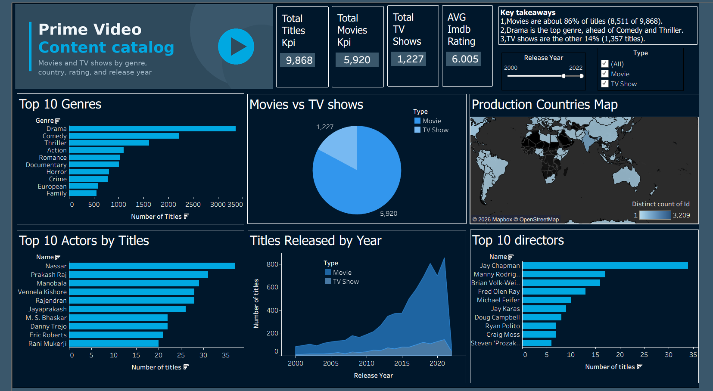

# Amazon Prime Video Catalogue Dashboard

## Project Overview

This project explores the Amazon Prime Video catalogue using Python for data cleaning and Tableau for data visualization. The goal is to understand the catalogue's content distribution, genres, countries, release trends, ratings, and credits.

The project includes a cleaned dataset, a Python data-cleaning notebook, an interactive Tableau dashboard, and a dashboard preview.

## Live Tableau Dashboard

**Explore the interactive dashboard:**  
[View Amazon Prime Video Dashboard on Tableau Public](https://public.tableau.com/app/profile/vaibhav.deshmukh3072/viz/Amazon_Prime_Video_DashboardTablaeu/Dashboard1?publish=yes)

## Dashboard Preview



## Questions I Wanted to Answer

1. What is the catalogue made of, and how many movies and TV shows are included?
2. Which genres and production countries are most represented?
3. How has the number of releases changed over the years?
4. Which actors and directors are credited on the most titles?
5. What is the average IMDb score of titles in the catalogue?


## Key Findings

- The cleaned catalogue contains **9,868 titles**.
- It includes **8,511 movies (approximately 86.3%)** and **1,357 TV shows (approximately 13.7%)**.
- Drama is the leading genre, followed by Comedy, Thriller, Action, and Romance.
- The average IMDb score is approximately **5.98 out of 10**.
- The number of releases increases in more recent years. The peak year should be confirmed from the dashboard.
- Production is concentrated in several countries. The leading country should be confirmed from the dashboard.
- Joseph Kane, Sam Newfield, and Jay Chapman are among the directors with the most titles in this analysis.

\*\*Live Dashboard:\*\*  \
 bb1761dce246a2f63f69014a7c5bd8b65a6b6626

*Note: These findings describe the dataset used in this project and do not necessarily represent the current Amazon Prime Video catalogue.*

## Dataset

The cleaned Excel workbook is `data/amazon_prime_clean.xlsx` and contains four worksheets:

| Worksheet | Description |
|---|---|
| `titles_clean` | Title-level information, including content type, release year, runtime, certification, and ratings |
| `title_genres` | Title-to-genre associations |
| `title_countries` | Title-to-country associations |
| `credits_clean` | Actors, directors, and other available credit information |

## Data Cleaning and Preparation

I used **Python, Pandas, and Google Colab** to clean and prepare the data for analysis. The notebook is available in the `notebooks` folder.

The cleaning and preparation workflow includes:

- Inspecting the dataset and its columns.
- Handling missing and inconsistent values where appropriate.
- Preparing title, genre, country, and credit information for analysis.
- Organizing the cleaned data into worksheets for use in Tableau.
- Exporting the prepared data to an Excel workbook.

The original cleaning workflow is documented in `notebooks/Amazon_Prime_Video_Data_Cleaning.ipynb`.

## Tableau Data Model

The cleaned workbook contains separate worksheets for titles, genres, countries, and credits. These tables support analysis of content types, genre distribution, production countries, ratings, and people associated with titles.

When connecting the worksheets in Tableau, the relationships should be based on the appropriate title identifiers. Care should be taken to avoid duplicate counts when a title has multiple genres, countries, actors, or directors.

## Dashboard Features

The dashboard is designed to help users explore the catalogue through visual summaries and comparisons.

| Analysis Area | Purpose |
|---|---|
| Content distribution | Compare movies and TV shows |
| Genre analysis | Identify the most represented genres |
| Country analysis | Explore production-country distribution |
| Release trends | Examine how releases vary by year |
| Ratings | Explore available IMDb ratings |
| Credits | Analyze actors and directors associated with titles |

*The exact visuals and interactive controls are available in the published Tableau dashboard.*

## Tools and Technologies

- **Python** — data preparation and cleaning
- **Pandas** — data manipulation
- **Jupyter Notebook / Google Colab** — documenting the cleaning workflow
- **Microsoft Excel** — storing the cleaned worksheets
- **Tableau** — data visualization and interactive dashboard creation
- **Git and GitHub** — version control and project portfolio hosting

## Repository Structure

```text
prime-video-tableau-dashboard/
│
├── dashboard/
│   ├── Amazon_Prime_Video_Dashboard.twbx
│   └── dashboard_preview.png
│
├── data/
│   └── amazon_prime_clean.xlsx
│
├── notebooks/
│   └── Amazon_Prime_Video_Data_Cleaning.ipynb
│
├── .gitignore
└── README.md
```

## Challenges and Learnings

Through this project, I practiced:

- Cleaning and preparing real-world catalogue data.
- Working with multiple related datasets.
- Building visualizations for exploratory data analysis.
- Designing an interactive dashboard in Tableau.
- Communicating findings through data storytelling.
- Organizing a data analytics project for a GitHub portfolio.

## Limitations

- Findings depend on the dataset used in this project and may not represent the current catalogue.
- Missing values and data quality issues may affect some analyses.
- Genre, country, and credit relationships can create duplicate counts if not modeled correctly.
- Some observations, such as the peak release year and leading production country, should be verified directly against the dashboard.

## Author

**Vaibhav Deshmukh**

- GitHub: [vaibhavd8080](https://github.com/vaibhavd8080)
- Tableau Public: [View my Tableau profile](https://public.tableau.com/app/profile/vaibhav.deshmukh3072)

---

If you find this project useful, feel free to explore the dashboard and the project files.
