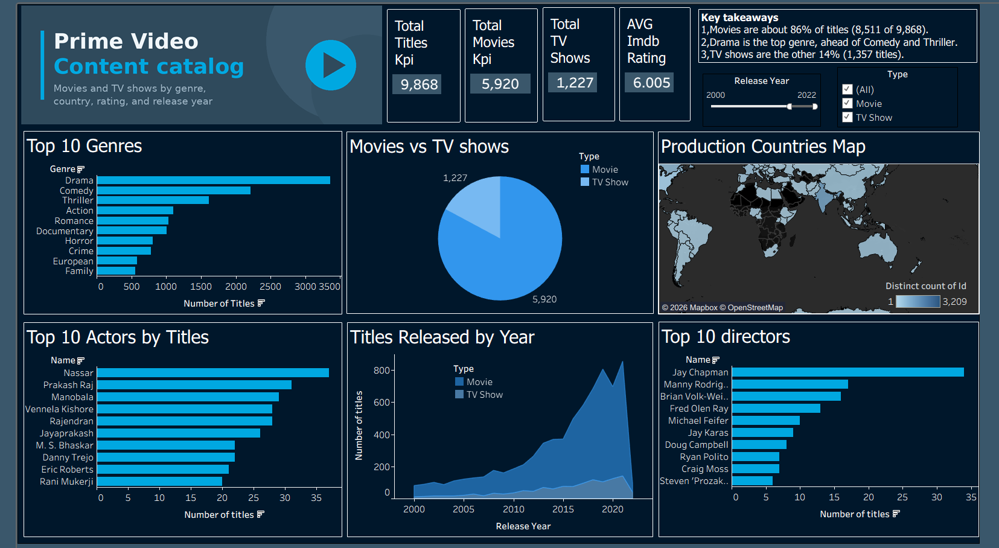

# Amazon Prime Video Catalogue Dashboard — Tableau

An interactive Tableau dashboard built from an Amazon Prime Video catalogue dataset. Python and Pandas were used to prepare the data; Tableau was used to explore catalogue composition and related attributes.

## Live dashboard

[Open the Amazon Prime Video dashboard on Tableau Public](https://public.tableau.com/app/profile/vaibhav.deshmukh3072/viz/Amazon_Prime_Video_DashboardTablaeu/Dashboard1?publish=yes)

## Dashboard preview

## Project questions

The dashboard is intended to explore:

- How many movies and TV shows are represented in the dataset?
- How is the catalogue distributed across genres and production countries?
- How do title counts vary by release year?
- What IMDb rating information is available?
- Which actors and directors appear in the credits data?

## Verified data preparation results

The committed cleaning notebook records these results:

| Check | Before cleaning | After duplicate removal |
|---|---:|---:|
| Title records | 9,871 | 9,868 |
| Credit records | 124,235 | 124,179 |

The notebook reports that three duplicate rows were removed from the titles table and 56 duplicate rows from the credits table. These are data-preparation counts, not measures of the current Amazon Prime Video catalogue.

The notebook is available at [Amazon_Prime_Video_Data_Cleaning.ipynb](notebooks/Amazon_Prime_Video_Data_Cleaning.ipynb).

## Project files

- [Tableau packaged workbook (.twbx)](dashboard/Amazon_Prime_Video_Dashboard.twbx)
- [Cleaned Excel workbook](data/amazon_prime_clean.xlsx)
- [Python data-cleaning notebook](notebooks/Amazon_Prime_Video_Data_Cleaning.ipynb)
- [Dashboard preview image](dashboard/dashboard_preview.png)

## Data model

The cleaned Excel workbook contains these worksheets:

| Worksheet | Purpose |
|---|---|
| \`titles_clean\` | Title-level attributes |
| \`title_genres\` | Title-to-genre associations |
| \`title_countries\` | Title-to-country associations |
| \`credits_clean\` | Actor and director credit information |

When analysing these tables, use the title identifier to relate records. A title can have multiple genres, countries or credits, so joining tables without considering their grain can multiply title rows and inflate counts.

## Preparation workflow

The committed notebook documents the following steps:

1. Load the titles and credits CSV files.
2. Inspect table dimensions and duplicate records.
3. Remove exact duplicate rows.
4. Prepare title, genre, country and credit data for analysis.
5. Export the prepared tables for use in Tableau.

The notebook uses Google Colab-style input paths. To rerun it outside the original Colab session, update the input and output paths to match the local folder structure.

## Tools

- Python and Pandas
- NumPy
- Google Colab / Jupyter Notebook
- Microsoft Excel
- Tableau
- Git and GitHub

## Limitations

- This is a historical dataset analysis, not a live feed of the current Prime Video catalogue.
- The committed notebook documents duplicate removal and data preparation; missing values and source-data quality can still affect individual views.
- Genre, country and credits tables have one-to-many relationships with titles. Counts should be based on distinct title identifiers where appropriate.
- The Tableau Public URL is provided for convenience; the packaged workbook and preview are also included in this repository.

## Author

**Vaibhav Deshmukh**  
[GitHub profile](https://github.com/vaibhavd8080) · [Tableau Public profile](https://public.tableau.com/app/profile/vaibhav.deshmukh3072)